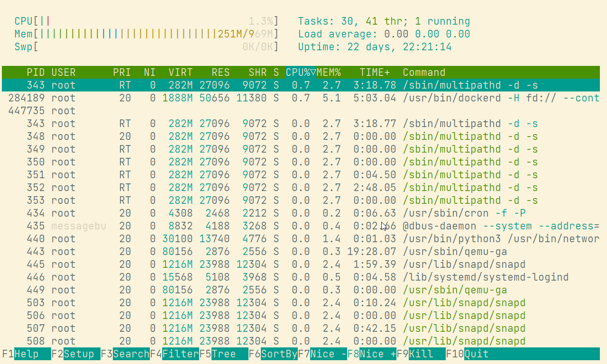

# Selenized color palette for MobaXterm

## Installation

1. Open global or session 'Terminal color settings' and add one of the color schemes from this folder
2. Save your new settings for your current session or all tabs by default.

  

3. Create the new tab for any your connection to test the selenized palette

  
